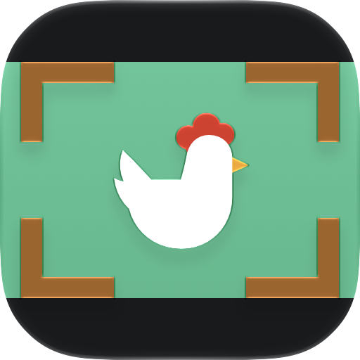
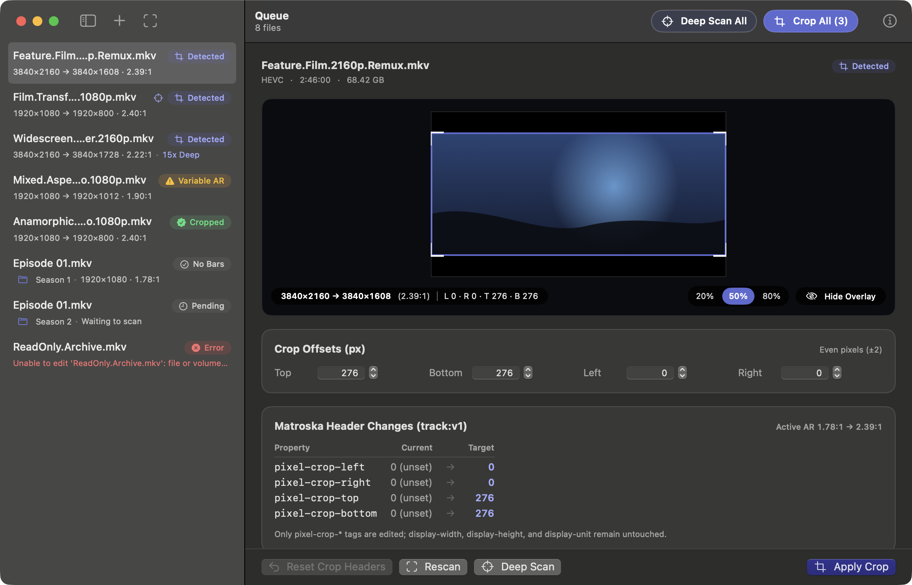
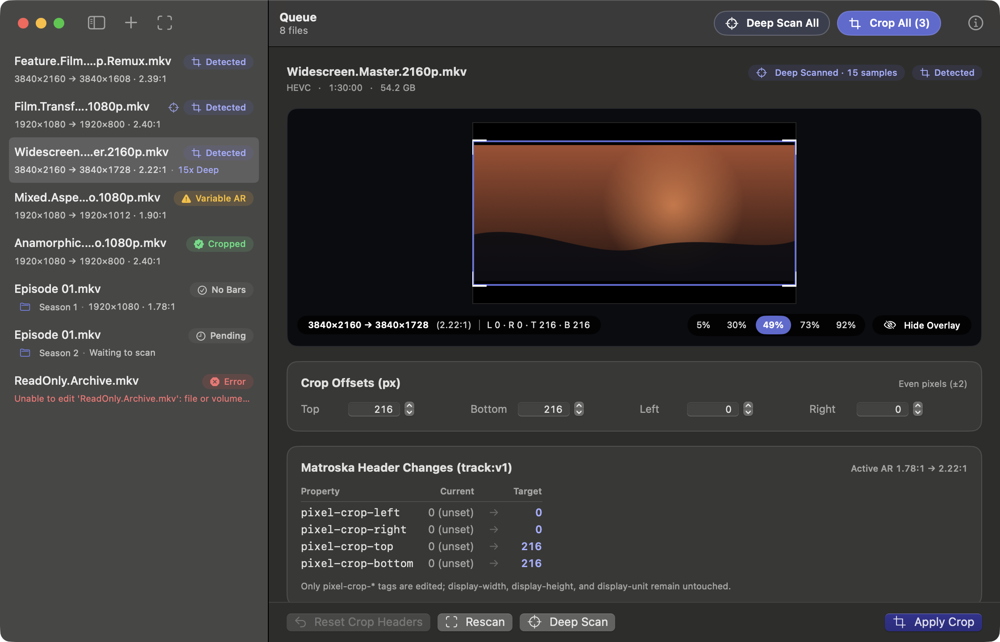
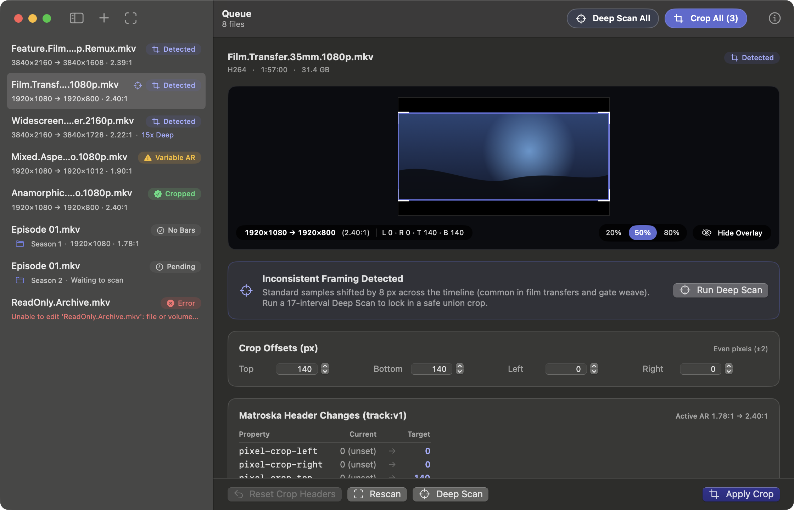
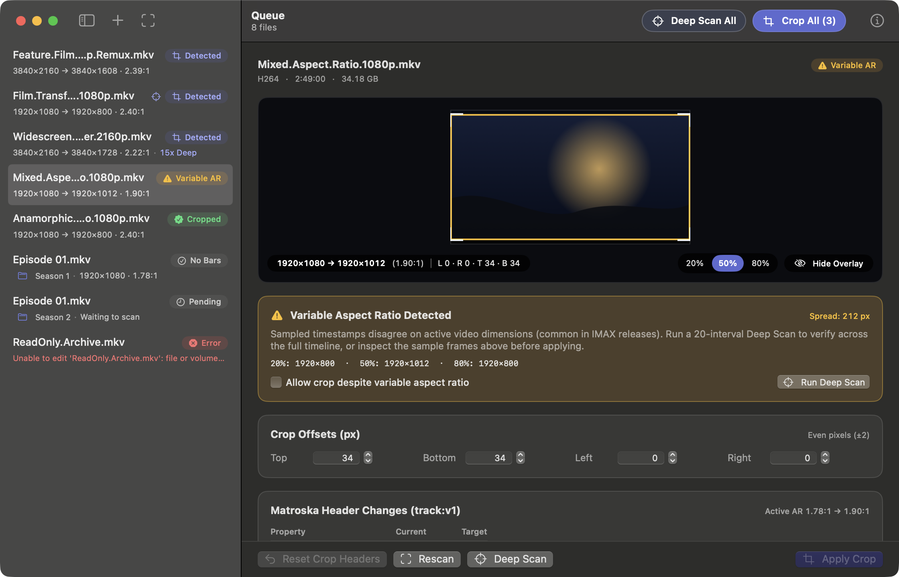

<h1 align="center">CropBlock</h1>

<p align="center">
  
</p>

<p align="center">
  <a href="https://github.com/MobiusGT/CropBlock/releases">
    
  </a>
  <a href="https://github.com/MobiusGT/CropBlock/blob/main/LICENSE">
    
  </a>
  
</p>

---

A lightweight, native macOS SwiftUI desktop app that automatically detects black letterbox and pillarbox bars in MKV files using `ffmpeg` (`cropdetect`) and removes them losslessly in-place by editing Matroska `pixel-crop-*` headers with `mkvpropedit`.

- **Zero re-encoding** — updates only the four `pixel-crop-left/right/top/bottom` header tags on `track:v1` in milliseconds (`display-width`, `display-height`, and `display-unit` are left untouched).
- **Safe multi-timestamp detection & Deep Scan** — standard scan samples across `20%`, `50%`, `80%` (10 s each); **Deep Scan** (per-file or **Deep Scan All**) scales intervals by video duration (`10` intervals ≤ 25 min, `+1` per 15 min past 25 min, skipping 5% intro / 8% credit tails, or a full-video pass on short clips) and extracts up to 5 representative preview frames including any outlier scenes.
- **Smart Deep Scan suggestions** — automatically flags Variable AR (IMAX shifts), subtle film-transfer gate-weave / edge jitter (≥ 4 px), or pure-black standard samples with a 1-click **Run Deep Scan** recommendation.
- **Codec-accurate re-scanning** — uses `-apply_cropping codec` so H.264/HEVC macroblock padding (e.g., `1088 → 1080`) is handled accurately while ignoring existing container crop flags.
- **Visual verification, fine-tuning & batch Crop All** — previews SAR-corrected frames with dimmed bars, crisp crop boundaries, live `±2 px` manual offset steppers, a before-and-after Matroska header diff, and 1-click **Crop All** (automatically skipping `No Bars`, `Error`, and unconfirmed `Variable AR` files).
- **1-Click Undo / Restore** — records original `pixel-crop-*` header states locally (distinguishing absent vs. explicit `0` elements via a pure-Swift EBML `SeekHead` reader) so edits can be reversed cleanly even after restarting.
- **Native macOS 15+ & macOS 26 Liquid Glass** — built in pure Swift 6 + SwiftUI with Universal Binary (`arm64` + `x86_64`) support.

---

## Screenshots

<table>
  <tr>
    <td align="center" width="50%">
      
      <br>
      <sub><strong>Crop Detection &amp; Header Diff</strong> — Live preview, ±2 px offsets, and <code>pixel-crop-*</code> changes.</sub>
    </td>
    <td align="center" width="50%">
      
      <br>
      <sub><strong>Deep Scan</strong> — Duration-scaled sampling with a 5-frame timeline switcher.</sub>
    </td>
  </tr>
  <tr>
    <td align="center" width="50%">
      
      <br>
      <sub><strong>Smart Framing Suggestion</strong> — Flags subtle edge jitter with 1-click Deep Scan.</sub>
    </td>
    <td align="center" width="50%">
      
      <br>
      <sub><strong>Variable AR Guard</strong> — Protects mixed-aspect-ratio titles until confirmed.</sub>
    </td>
  </tr>
</table>

---

## Installation

### 1. Download Crop Block
Download the latest Universal `.dmg` (`CropBlock-<version>-universal.dmg`) from [GitHub Releases](https://github.com/MobiusGT/CropBlock/releases), open it, and drag **Crop Block** into `/Applications`.

Optional checksum verification:
```bash
shasum -a 256 -c CropBlock-<version>-universal.dmg.sha256
```

### 2. macOS Gatekeeper Note (Ad-hoc Signed Releases)
GitHub Release builds are ad-hoc signed without a paid Apple Developer ID certificate. On first launch, macOS Gatekeeper may display an *"unidentified developer"* or *"damaged"* warning for quarantined downloads.

You can allow the app in either of two ways:
- **Terminal** (fastest):
  ```bash
  xattr -cr /Applications/CropBlock.app
  ```
- **System Settings**: Try opening **Crop Block**, then open **System Settings → Privacy & Security**, scroll to **Security**, and click **Open Anyway**.

### 3. Install Required Command-Line Tools
Crop Block delegates media probing and lossless MKV header editing to local copies of `ffmpeg`, `ffprobe`, and `mkvpropedit`. Install both packages with [Homebrew](https://brew.sh):

```bash
brew install ffmpeg mkvtoolnix
```

If any binary is missing when you launch Crop Block, a non-blocking **Tool Setup** sheet walks you through installing via Homebrew or browsing to custom binaries.

**Binary lookup priority (`ToolResolver`)**:
1. Explicit custom paths set in **Settings → Tools**
2. Bundled helpers in `CropBlock.app/Contents/Helpers/` (when present)
3. Homebrew (`/opt/homebrew/bin`, `/usr/local/bin`) and `$PATH`

---

## Player Compatibility

Crop Block edits standard Matroska `PixelCropLeft`, `PixelCropRight`, `PixelCropTop`, and `PixelCropBottom` header elements on `track:v1` without touching the encoded video bitstream or `DisplayWidth`/`DisplayHeight`/`DisplayUnit`.

| Player / Client | Matroska `PixelCrop*` Support |
| --- | --- |
| **mpv** / **IINA** (mpv-based) | Supported |
| **MPC-BE** | Supported |
| **Kodi** | Supported |
| **VLC**, web browsers, many smart TV / streaming clients | Improper Playback |

> A future bitstream cropping backend (`h264_metadata` / `hevc_metadata`) is accounted for in the `CropBackend` protocol architecture for players that ignore container crop headers.

---

## Building from Source

Requirements: macOS 15+ (Xcode / Swift 6.2+ toolchain; macOS 26 SDK recommended for Liquid Glass icon compilation).

```bash
# Run Swift Testing unit & integration tests
swift test

# Build and install ~/Applications/CropBlock.app
./build.sh --open
```

### Packaging a Universal GitHub Release DMG

```bash
# Default: Universal Binary (arm64 + x86_64), ad-hoc signed, outputs dist/CropBlock-<version>-universal.dmg + .sha256
./scripts/release.sh
```

Optional release flags:
- `VERSION=1.0.0` — override release version string.
- `BUNDLE_HELPERS_DIR=/path/to/helpers` — embed self-contained `ffmpeg`, `ffprobe`, and `mkvpropedit` into `Contents/Helpers/`.
- `DEVELOPER_ID="Developer ID Application: ..."` — sign with Hardened Runtime instead of ad-hoc.
- `NOTARY_PROFILE="your-profile"` — submit signed DMG to `xcrun notarytool` and staple (requires `DEVELOPER_ID`).

---

## Architecture

- **`Sources/CropBlockKit/`** — Pure-Swift, SwiftUI-free core library (`CropCalculator`, `MatroskaHeaderReader` with `SeekHead` EOF support, `ToolResolver`, `ProcessRunner`, `CropDetectRunner`, `FrameExtractor`, `MKVFileDiscovery`, `CropBackend` + `MKVHeaderCropBackend`, `BatchApplyPlanner`, `ReceiptStore`).
- **`Sources/CropBlock/`** — Native macOS SwiftUI app (`NavigationSplitView` queue & detail workspace, SAR-corrected preview canvas, manual offset steppers, 4-tab Settings, Tool Setup sheet, Player Compatibility popover).
- **`Tests/CropBlockKitTests/`** — Swift Testing unit and live `ffmpeg`/`mkvpropedit` round-trip tests.

---
## AI Disclosure

  <em>Fully made using <strong>Gemini 4 Neon Extra High</strong>.</em>

---

## License

Copyright © 2026 MobiusGT.

Crop Block is free software licensed under the **GNU General Public License v3.0 (`GPL-3.0`)**. See [LICENSE](LICENSE) for the full license text.

